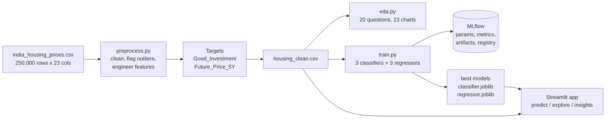

# 🏠 Real Estate Investment Advisor
### Predicting property profitability and 5-year future value

**🚀 Live app: [https://realestateadvisor-vga53jpujrkqvfsxy2xt9d.streamlit.app/](https://realestateadvisor-vga53jpujrkqvfsxy2xt9d.streamlit.app/)**

A machine-learning application that helps investors evaluate residential property in India. For any property it answers two questions:

1. **Is this a Good Investment?** — binary classification
2. **What will it be worth in 5 years?** — regression

The project covers data cleaning, feature engineering, EDA (20 questions), six models tracked in **MLflow**, and an interactive **Streamlit** app.

**Domain:** Real Estate / Investment / Financial Analytics
**Skills:** Python, Pandas, Scikit-learn, XGBoost, EDA, feature engineering, regression, classification, MLflow, Streamlit

---

## Results at a glance

| Task | Best model | Key metrics (50,000-property test set) |
|---|---|---|
| Good Investment classification | **XGBoost** | Accuracy 99.4%, F1 0.993, ROC-AUC 0.9998 |
| 5-year price regression | **XGBoost** | RMSE ₹1.74 L, MAE ₹1.35 L, R² 0.99994, MAPE 0.54% |

Full comparison in [`reports/model_results.md`](reports/model_results.md).

> **Important context.** The dataset contains no real investment outcomes and no historical prices, so both targets were **engineered from documented domain rules** (see [Target variables](#3-target-variables)). The high scores show that the models learned those rules accurately; they are not evidence of predicting real market returns. The EDA also shows that the raw features are statistically independent of price (size vs price r = −0.003), so the dataset appears to be synthetic. Both points are stated openly here, and they are good to raise in your presentation.

---

## Project structure

```
real_estate_advisor/
├── app.py                     # Streamlit app (3 pages)
├── requirements.txt
├── data/
│   ├── raw/india_housing_prices.csv
│   └── processed/housing_clean.csv     # created by src/preprocess.py
├── src/
│   ├── features.py            # shared feature engineering + target rules
│   ├── preprocess.py          # Step 1: cleaning, outliers, features, targets
│   ├── eda.py                 # Step 2: 20 EDA questions -> charts + findings
│   └── train.py               # Steps 3-4: 6 models, MLflow tracking, model selection
├── models/
│   ├── classifier.joblib      # best classifier pipeline (preprocessing + model)
│   ├── regressor.joblib       # best regressor pipeline
│   ├── model_meta.json        # metrics + feature importances (read by the app)
│   └── lookups.json           # city medians, state->city->locality lists
├── reports/
│   ├── data_quality.md        # cleaning + outlier report
│   ├── eda_findings.md        # answers to all 20 EDA questions, with charts
│   ├── model_results.md       # model comparison tables
│   └── figures/               # EDA charts + model charts (figures/models/)
└── mlflow.db                  # MLflow tracking store (created by train.py)
```

## How to run

```bash
pip install -r requirements.txt

python src/preprocess.py     # ~10 s  -> data/processed/housing_clean.csv
python src/eda.py            # ~10 s  -> reports/eda_findings.md + 23 charts
python src/train.py          # ~8 min -> models/*.joblib + MLflow runs
                             #   (Random Forest regressor takes most of this time)
streamlit run app.py         # opens http://localhost:8501

mlflow ui --backend-store-uri sqlite:///mlflow.db   # browse experiments at http://127.0.0.1:5000
```

If you see an error loading `classifier.joblib` or `regressor.joblib`, your scikit-learn/XGBoost version differs from the one used to train them. Rerun `python src/train.py`.

---

## Data flow and architecture



Each model is a single scikit-learn `Pipeline` (`StandardScaler` + `OneHotEncoder` → model), so the app sends raw form inputs through exactly the same transformations used in training. `src/features.py` is shared by training and the app for the same reason.

---

## Methodology

### 1. Data preprocessing — `src/preprocess.py`

| Check | Finding | Action |
|---|---|---|
| Duplicates | 0 (also 0 when ignoring ID) | Dedup step kept for robustness |
| Missing values | 0 | Median (numeric) / mode (categorical) imputation coded for robustness |
| Floor_No > Total_Floors | **116,304 rows (46.5%)** — impossible | Flagged (`Floor_Inconsistent`) and capped at Total_Floors |
| Price_per_SqFt precision | Raw column is lakhs/sq ft rounded to 2 dp (e.g. 0.09) | Recomputed precisely in ₹: `Price_per_SqFt_Rs` |
| Outliers (IQR) | Price per sq ft: 19,723 (7.9%), all high; price and size: none | Flagged, not removed (high rates on small homes are plausible; tree models are robust) |

Full report: [`reports/data_quality.md`](reports/data_quality.md)

**Engineered features**

| Feature | Definition |
|---|---|
| `Price_per_SqFt_Rs` | Price × 100,000 ÷ size |
| `PPSF_vs_City_Median` | Property's ₹/sq ft ÷ its city's median — below 1 means cheaper than the local market |
| `Infra_Score` | Nearby schools + nearby hospitals (2–20) |
| `School_Density_Score` | Nearby schools ÷ 10 |
| `Transport_Score` | Low = 1, Medium = 2, High = 3 |
| `Has_Gym`, `Has_Pool`, … `Amenity_Count` | Multi-value Amenities text split into 5 flags + count |
| `Floor_Ratio` | Floor ÷ total floors |
| `Parking`, `Has_Security` | Yes/No → 1/0 |

Categorical columns (State, City, Property type, Furnishing, Transport, Facing, Owner type, Availability) are one-hot encoded inside the pipeline; numeric features are standard-scaled. `Locality` (500 levels) and `ID` are excluded from modelling; Locality is used in the app for selection and display.

### 2. Exploratory data analysis — `src/eda.py`

All 20 questions are answered with computed numbers and a chart in [`reports/eda_findings.md`](reports/eda_findings.md). Highlights:

- **Size and price are unrelated** (r = −0.003). Bigger homes are not more expensive — the clearest sign the data is synthetic.
- **Location barely matters for current price.** Average price varies by only 3.1% across 42 cities and 2.5% across 20 states.
- Property type, furnishing, facing, parking and amenities each move price by less than 1.5%.
- Every city has about 20% of listings in each BHK from 1 to 5.
- **Investment potential is where the variation is:** 10% of Low-transport properties are Good Investments, vs 63% of High-transport ones.
- Larger homes are more often Good Investments (29% under 1,000 sq ft vs 53% at 4,000–5,000 sq ft) because their ₹/sq ft is lower.
- **Gaps in the brief vs the data:** no crime-rate column (Security is used as a proxy), no "Sold" status, and Parking_Space is Yes/No rather than a count.

### 3. Target variables

Neither target exists in the raw data, so both are built from transparent rules in `src/features.py`.

**Future_Price_5Y** = `Price_in_Lakhs × (1 + r)^5`, where the annual appreciation rate *r* is:

| Component | Adjustment |
|---|---|
| Base long-run growth | 8.0% |
| Public transport | High +1.0%, Medium +0.5% |
| Property type | Villa +0.5%, Independent House +0.3% |
| Furnishing | Furnished +0.2%, Semi +0.1% |
| Infrastructure | (Infra_Score − 11) ÷ 18 × 1% (about ±0.5%) |
| Under construction | +1.0% (pre-completion appreciation) |
| Age | −0.05% per year of age |
| Amenities | +0.2% per amenity |
| Security / parking | +0.3% / +0.2% |

The resulting *r* ranges from 6.1% to 12.5% (median 9.3%).

**Good_Investment = 1** when a property meets **at least 3 of these 4 rules**:

1. **Value buy** — ₹/sq ft at or below the city median
2. **High growth** — appreciation rate at or above the dataset median (9.3%)
3. **Good infrastructure** — schools + hospitals ≥ 11
4. **Well connected** — public transport Medium or High

This gives 41.7% positives, a reasonably balanced target. The models are not given the targets, the growth rate or the rule flags as inputs — only the property features.

### 4. Modelling and MLflow — `src/train.py`

80/20 train/test split (stratified on Good_Investment, `random_state=42`).

| Classification | Accuracy | Precision | Recall | F1 | ROC-AUC |
|---|---|---|---|---|---|
| Logistic Regression | 0.8867 | 0.8655 | 0.8627 | 0.8641 | 0.9608 |
| Random Forest | 0.9620 | 0.9546 | 0.9542 | 0.9544 | 0.9950 |
| **XGBoost** | **0.9942** | **0.9930** | **0.9931** | **0.9931** | **0.9998** |

| Regression (₹ lakhs) | RMSE | MAE | R² | MAPE |
|---|---|---|---|---|
| Linear Regression | 9.516 | 6.653 | 0.99816 | 4.64% |
| Random Forest | 6.470 | 4.654 | 0.99915 | 1.27% |
| **XGBoost** | **1.736** | **1.351** | **0.99994** | **0.54%** |

**Why XGBoost wins.** The targets combine thresholds (the 3-of-4 rule) and multiplication (price × growth factor). Linear models can't represent these interactions exactly; boosted trees approximate them very closely.

**Top features.** For the classifier: transport access, value vs city median, availability status and infrastructure score — matching the investment rules. For the regressor: current price (~80% of importance), as expected for a growth-based forecast.

**MLflow tracking.** Every run logs its parameters, metrics, train time, confusion matrix or actual-vs-predicted plot, feature-importance plot and the full model pipeline. The best models are registered as `good_investment_classifier` and `future_price_regressor`.

### 5. Streamlit app — `app.py`

| Page | What it does |
|---|---|
| **Predict a property** | Form for all property details (State → City → Locality cascade). Shows the Yes/No verdict, model confidence, 5-year price, implied annual growth, which of the 4 rules pass, a projected price path and feature-importance charts. |
| **Explore the market** | Filter by state, city, property type, BHK, price, size and "Good Investments only". KPI tiles, city × property-type heatmap (% good / ₹ per sq ft / appreciation), charts, top-ranked properties table and CSV download. |
| **Model insights** | Comparison tables for all 6 models, confusion matrix, feature importance and actual-vs-predicted plots. |

---

## Business use cases

- **Investors** get a quick, consistent first screen of long-term return before deeper due diligence.
- **Buyers** can compare properties across cities and spot better-value, better-connected options.
- **Real estate platforms** can score every listing automatically and surface "good investment" badges.
- **Trust:** each verdict comes with the rules behind it and the model's confidence, rather than a black-box answer.

## Limitations and next steps

- **Rule-based targets.** The models reproduce the domain rules; with real transaction histories, the targets should be replaced with actual 5-year price changes.
- **Synthetic data.** Price is independent of size and location, so price-related insights won't transfer to real markets.
- **Fixed growth assumptions.** The 8% base rate and adjustments are assumptions; they could be calibrated against RBI/NHB housing price indices by city.
- **Next steps:** hyperparameter tuning logged in MLflow, SHAP explanations per prediction, and real data from listing portals.

## Deployment

The app is deployed on Streamlit Community Cloud: **https://realestateadvisor-vga53jpujrkqvfsxy2xt9d.streamlit.app/**

**Keeping it awake.** Free Community Cloud apps go to sleep after 12 hours without visitors. A GitHub Actions workflow ([`.github/workflows/keep_alive.yml`](.github/workflows/keep_alive.yml)) opens the app in a headless browser every 3 hours and clicks the wake-up button if it ever finds the app asleep. It can also be run by hand from the repo's **Actions** tab.

### Deploying your own copy

1. Push the project to GitHub. `.gitignore` excludes `data/processed/` and `mlartifacts/`, which are too large.
2. On share.streamlit.io, choose the repo and set the main file to `app.py`.
3. On first launch the app builds `housing_clean.csv` from the raw CSV automatically.
