# EDA findings

All numbers below are computed by `src/eda.py` from the cleaned data. Price per sq ft is in ₹ (`Price_per_SqFt_Rs`), prices in lakhs.

## 1-5: Price & size analysis

**Q1. What is the distribution of property prices?**  
Prices range from ₹10L to ₹500L with mean ₹255L and median ₹254L. Skewness is 0.01: the distribution is almost flat (uniform) rather than the right-skewed shape typical of real housing markets.

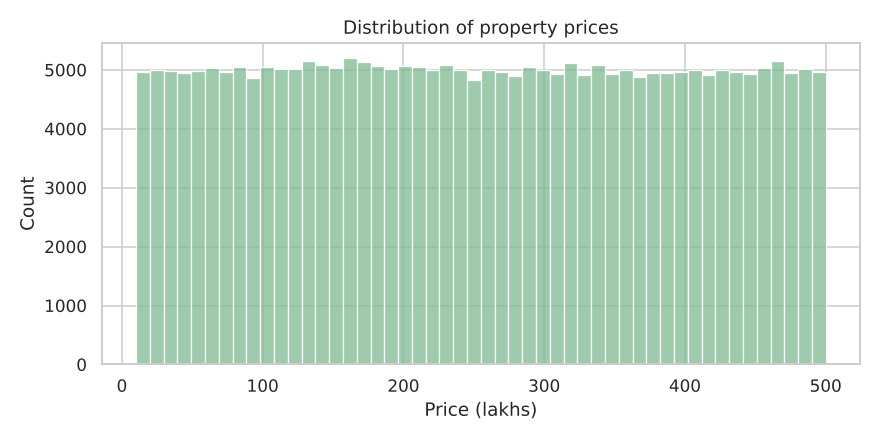

**Q2. What is the distribution of property sizes?**  
Sizes range from 500 to 5,000 sq ft (median 2,747). Like price, size is spread almost evenly across its range (skew 0.00).

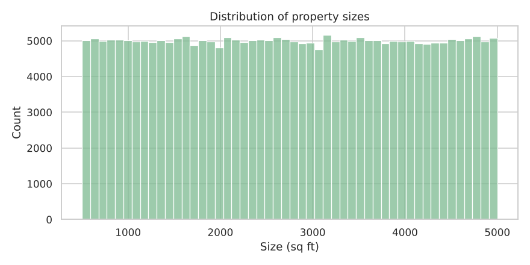

**Q3. How does price per sq ft vary by property type?**  
Median ₹/sq ft: Apartment ₹9,245, Independent House ₹9,305, Villa ₹9,190. The gap between types is only 1.2%, so property type barely changes the rate.

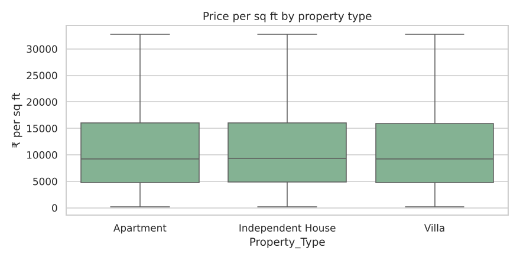

**Q4. Is there a relationship between property size and price?**  
No. The correlation is -0.003: bigger homes are not more expensive in this dataset. This is the most important finding of the EDA — in a real market this correlation is strongly positive. It suggests the dataset is synthetic, with columns generated independently.

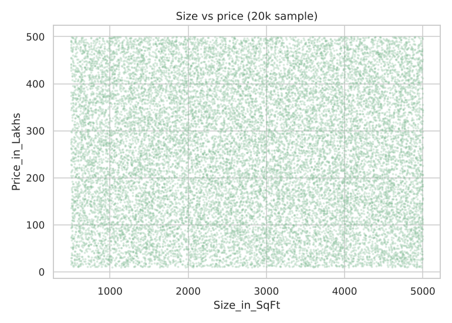

**Q5. Are there any outliers in price per sq ft or property size?**  
Price per sq ft: 19,723 outliers (7.9%) above the IQR upper fence, all on the high side (small homes with high prices). Size: none — it is bounded between 500 and 5,000 sq ft. Outliers were flagged, not dropped (see data_quality.md).

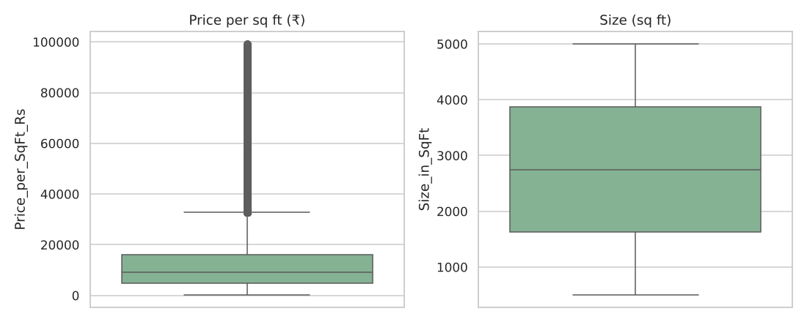

## 6-10: Location-based analysis

**Q6. What is the average price per sq ft by state?**  
Highest: Karnataka (₹13,252); lowest: Punjab (₹12,931). The spread across all 20 states is only 2.5%.

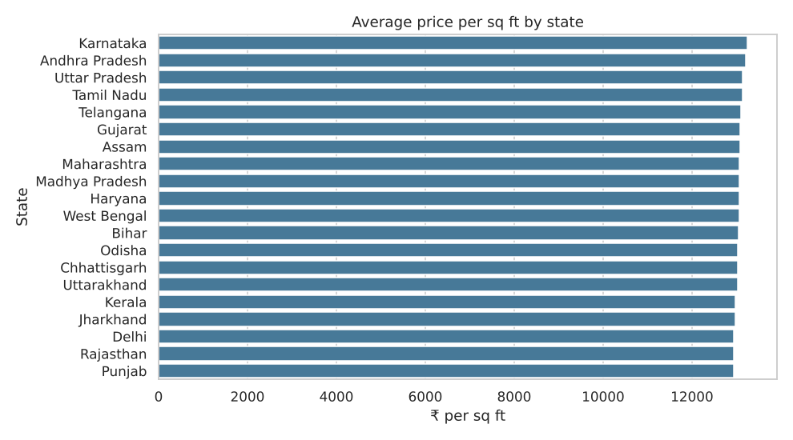

**Q7. What is the average property price by city?**  
Highest: Bangalore (₹258.5L); lowest: Cuttack (₹250.8L). Across 42 cities the averages differ by just 3.1% — location does not drive price here.

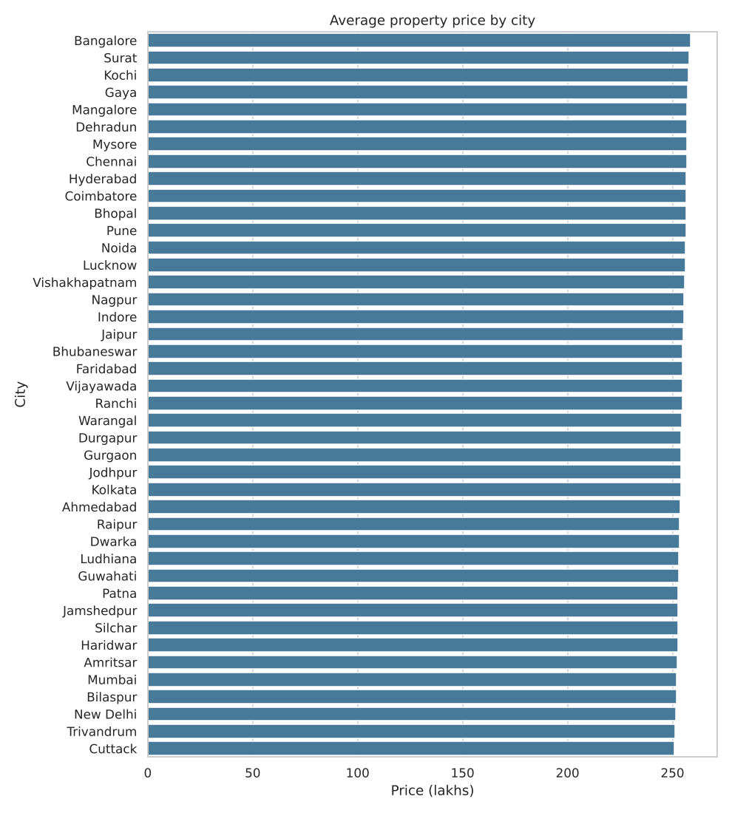

**Q8. What is the median age of properties by locality?**  
Locality medians range from 16 to 21 years (overall median 18). The histogram shows the distribution across all 500 localities; the full table is easy to produce with `groupby('Locality')`.

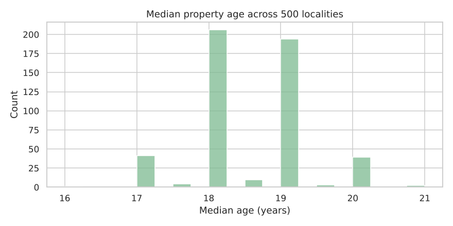

**Q9. How is BHK distributed across cities?**  
Every city has roughly 20% of listings in each BHK from 1 to 5 (range 18.6%-22.0%). No city skews toward small or large homes.

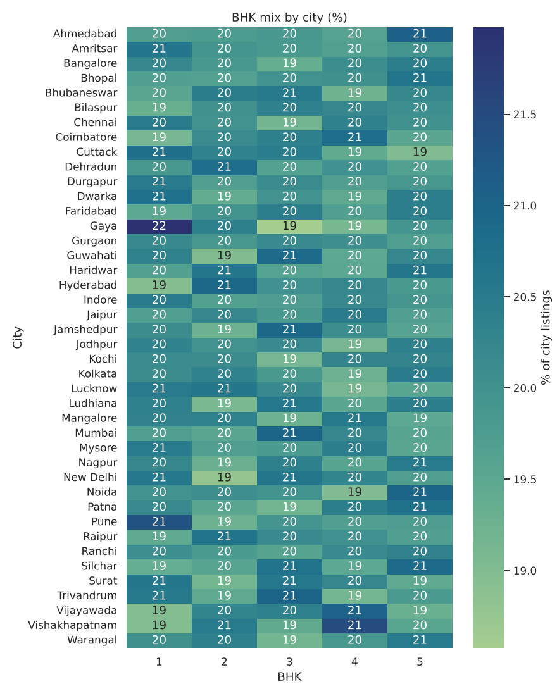

**Q10. What are the price trends for the top 5 most expensive localities?**  
Top 5 by average price: Locality_395, Locality_366, Locality_497, Locality_360, Locality_203. The data has no sale dates, so the trend uses construction year (5-year bins) as the time axis. Prices fluctuate between periods with no consistent upward or downward direction.

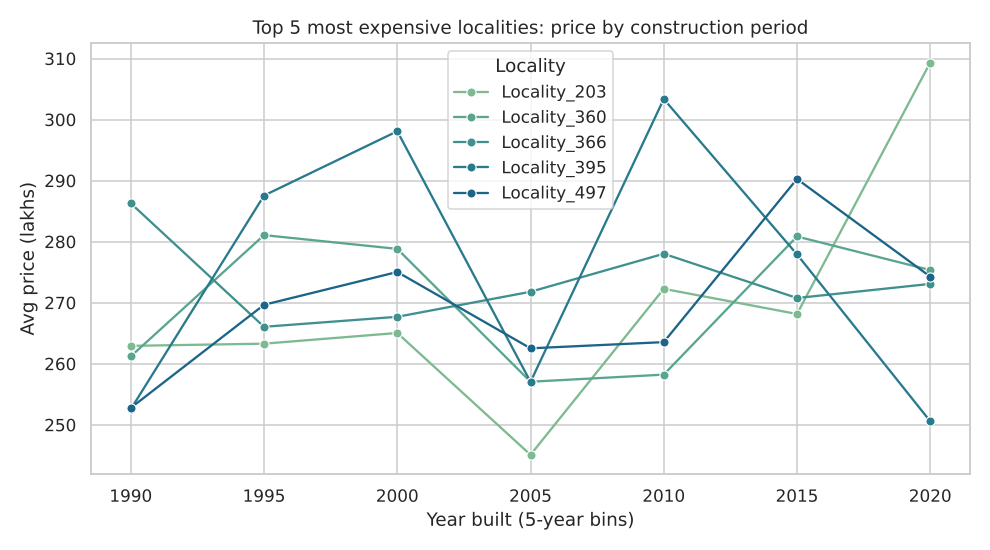

## 11-15: Feature relationships & correlation

**Q11. How are numeric features correlated with each other?**  
The raw features are essentially uncorrelated: the strongest pair is Size_in_SqFt vs Age_of_Property at |r| = 0.004. Floor_No vs Total_Floors is the exception (r = 0.58), caused by capping Floor_No during cleaning. The only strong correlations are derived ones: price per sq ft vs size (r = -0.61) and price (r = 0.56), and future price vs current price (r = 1.00).

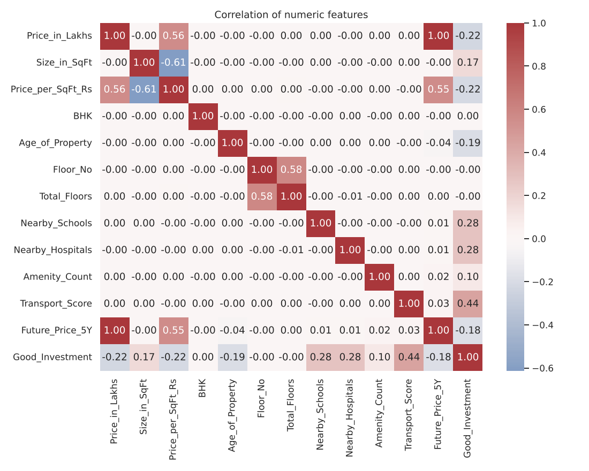

**Q12. How do nearby schools relate to price per sq ft?**  
Correlation -0.000. The average rate stays between ₹12,888 and ₹13,292 for 1 to 10 schools — no premium for more schools in current prices. (In the investment rules they do raise expected growth.)

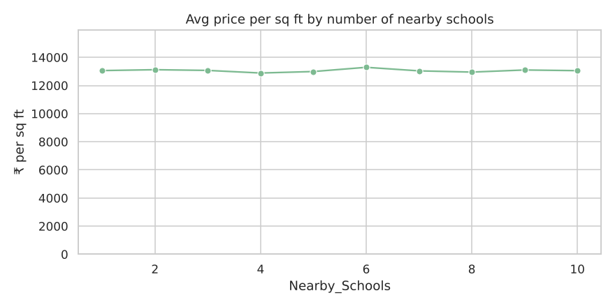

**Q13. How do nearby hospitals relate to price per sq ft?**  
Correlation -0.000. The average rate stays between ₹12,917 and ₹13,257 for 1 to 10 hospitals — no premium for more hospitals in current prices. (In the investment rules they do raise expected growth.)

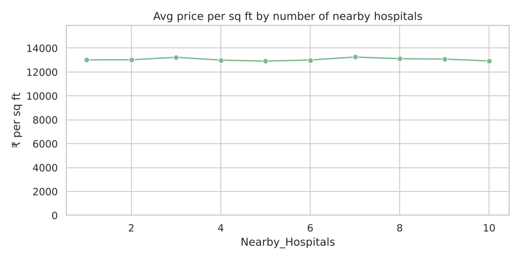

**Q14. How does price vary by furnished status?**  
Mean price: Furnished ₹254.4L, Semi-furnished ₹254.3L, Unfurnished ₹255.0L — a 0.3% spread, so furnishing has no visible effect on price.

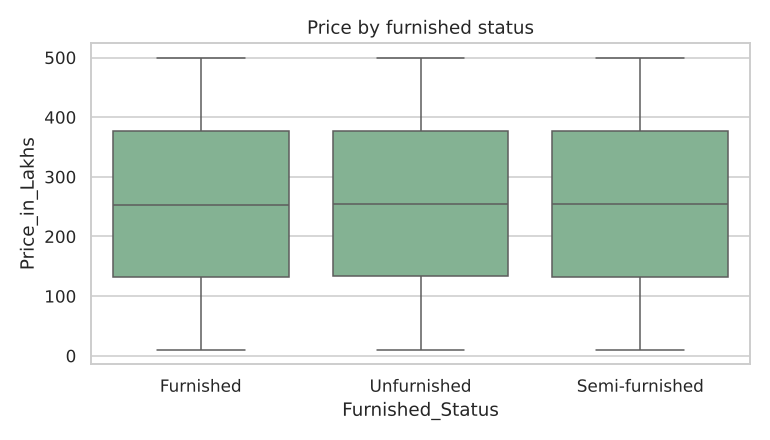

**Q15. How does price per sq ft vary by property facing direction?**  
Mean ₹/sq ft: East ₹13,024, North ₹13,025, South ₹13,044, West ₹13,140 (0.9% spread). Facing direction does not command a premium.

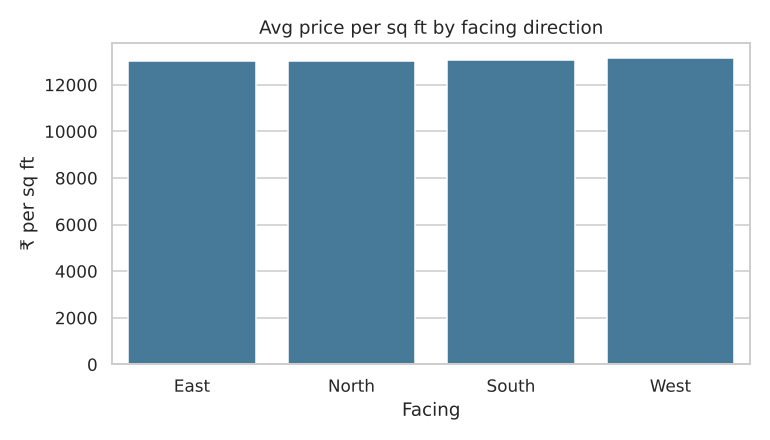

## 16-20: Investment, amenities & ownership

**Q16. How many properties belong to each owner type?**  
Broker: 83,479, Owner: 83,268, Builder: 83,253 — an even three-way split.

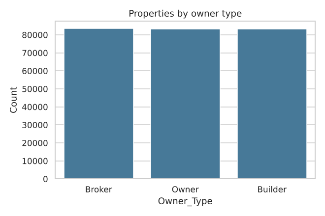

**Q17. How many properties are available under each availability status?**  
Under_Construction: 125,035, Ready_to_Move: 124,965. The brief mentions a 'Sold' status, but it does not appear in the data.

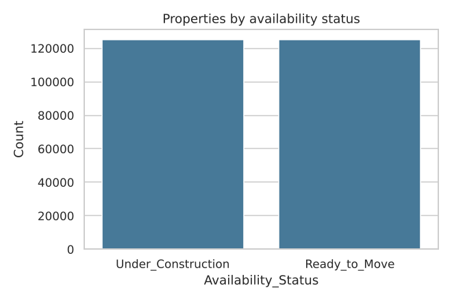

**Q18. Does parking space affect property price?**  
Mean price with parking ₹254.7L vs without ₹254.4L (0.1% difference). Parking does not affect price in this data. (Parking_Space is Yes/No, not a count as the brief describes.)

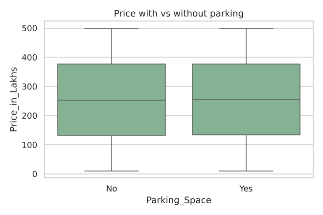

**Q19. How do amenities affect price per sq ft?**  
Each listing has 1-5 amenities. Average ₹/sq ft ranges from ₹13,015 to ₹13,102 across amenity counts (0.7% spread), and no single amenity carries a premium. Amenities matter for the investment score, not the current price.

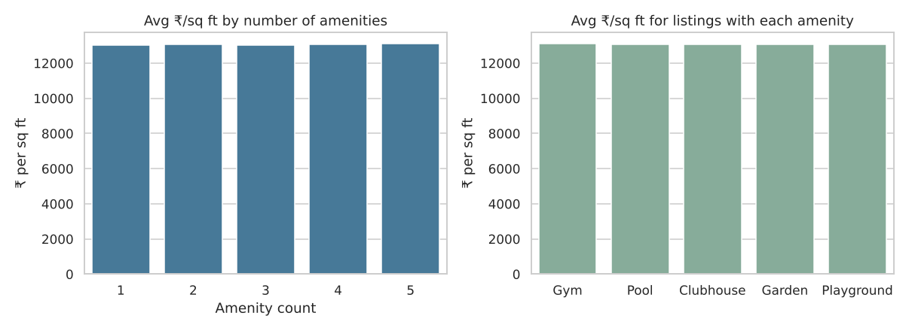

**Q20. How does public transport accessibility relate to price per sq ft or investment potential?**  
Current rate barely moves (Low ₹13,086, Medium ₹13,062, High ₹13,027), but investment potential does: Low 10%, Medium 52%, High 63% of properties are Good Investments. This is by design — transport access is one of the four investment rules and adds to expected appreciation.

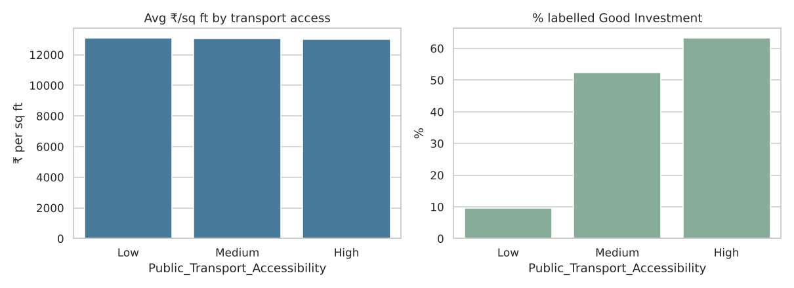

## Additional analysis from the Approach section

**Price trends by city.** Median ₹/sq ft ranges from ₹9,076 (Bilaspur) to ₹9,541 (Mangalore).

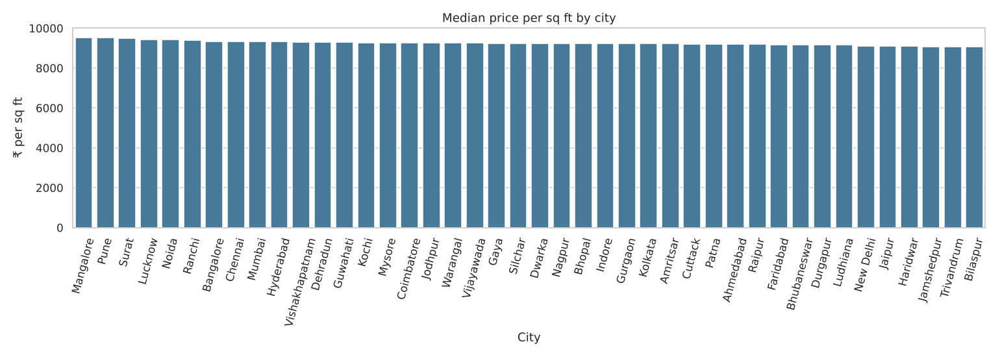

**Area vs investment return.** Share of Good Investments by size: <1k 29%, 1-2k 34%, 2-3k 41%, 3-4k 46%, 4-5k 53%. Larger homes have a lower ₹/sq ft and so pass the 'value buy' rule more often.

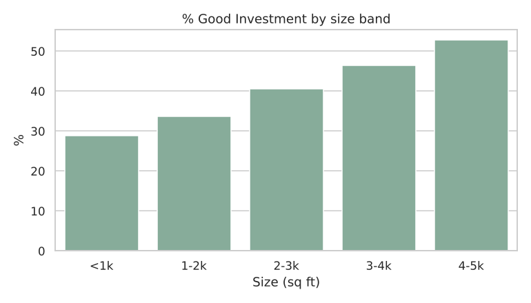

**Crime rate vs Good Investment.** The brief asks for this, but the dataset has no crime-rate column, so it cannot be analysed. The closest proxy is `Security` (gated/CCTV): 44% of properties with security are Good Investments vs 39% without.

**Infrastructure vs resale value.** Expected 5-year appreciation rises from 53% at the lowest infrastructure score to 60% at the highest.

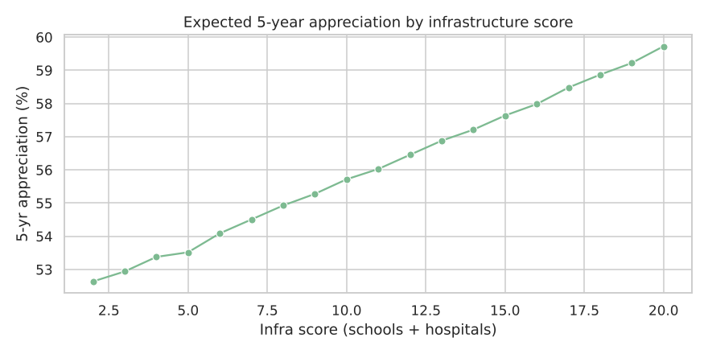

## Key takeaway

The raw features are statistically independent of price: size, location, amenities and BHK show no relationship with current price. The dataset appears to be synthetic. Investment value in this project therefore comes from the domain rules used to build the targets (see README), and the models learn those rules — this should be stated openly when presenting the project.
